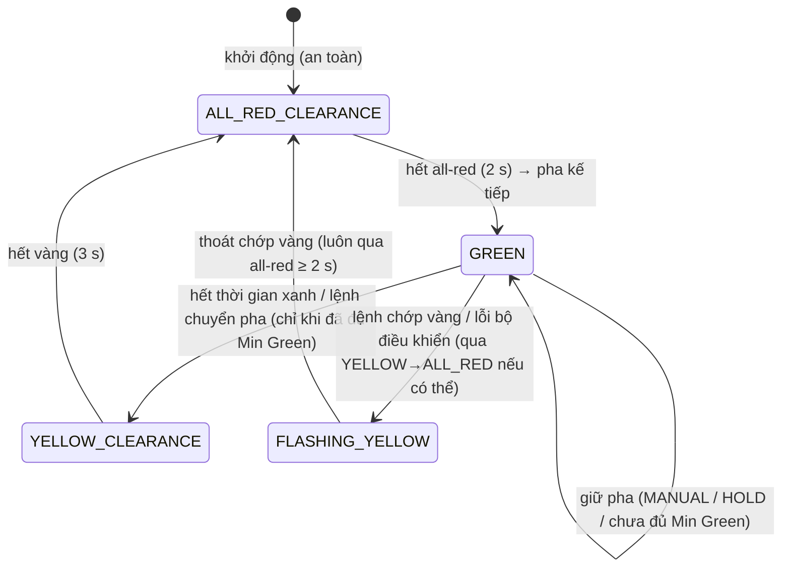

# STCS — Smart Traffic Control System · Kiến trúc hệ thống

> Phần mềm điều khiển giao thông tích hợp camera: giám sát nút giao qua camera, nhận diện & đếm phương tiện bằng AI,
> đánh giá mật độ, tối ưu chu kỳ đèn tín hiệu (Adaptive / Webster) với **bộ khoá an toàn (Safety Interlock)** bắt buộc.

---

## 1. Tổng quan

```
┌──────────────────────────────── FRONTEND (React 18 + TS + Vite + Tailwind) ───────────────────────────────┐
│  Live Command Center │ Analytics & AI Evaluation │ Alerts & Incidents │ System Config │ Users & Audit    │
│        ▲  WebSocket /ws/live (snapshot 4 Hz · frames 10 Hz · events)         ▲  REST /api/* (JWT Bearer)   │
└────────┼──────────────────────────────────────────────────────────────────────┼─────────────────────────────┘
         │                                                                      │
┌────────┴──────────────────────────────── BACKEND (FastAPI) ───────────────────┴─────────────────────────────┐
│ api/          REST routers + WebSocket hub (subscribe theo nút giao)                                         │
│ core/         Config · JWT/bcrypt · RBAC permissions · Audit Logger · Event Bus                              │
│ services/     IntersectionRuntime (vòng lặp 10 Hz) · AlertService · HeartbeatMonitor · StatsRecorder ·       │
│               EvaluationService · Seeder                                                                     │
│ control_engine/  Phase & Conflict Matrix · SafetyInterlockValidator · SignalControllerFSM ·                   │
│                  AdaptivePlanner (Webster) · TrafficSignalControllerAdapter (ACK, heartbeat, fault)          │
│ vision_engine/   CameraStreamManager (SIM / RTSP / HTTP / FILE) · TrafficSimulator · VehicleDetector         │
│                  (Synthetic / YOLO) · CentroidTracker · DirectionalCounter · DensityAnalyzer · Renderer      │
│ models/ schemas/ SQLAlchemy ORM (SQLite) · Pydantic v2 schemas                                               │
└──────────────────────────────────────────────────────────────────────────────────────────────────────────────┘
```

### 1.1 Luồng dữ liệu thời gian thực (mỗi tick 100 ms / nút giao)

```
TrafficSimulator ──(ground truth)──► CameraStreamManager ──frame──► VehicleDetector ──detections──► CentroidTracker
       ▲  (tôn trọng màu đèn từng hướng)        │ status ONLINE/DEGRADED/OFFLINE                         │ tracks
       │                                         ▼                                                        ▼
SignalControllerFSM ◄── AdaptivePlanner ◄── DensityAnalyzer ◄──────────────────────────────── DirectionalCounter
       │  (mọi trạng thái đèn qua SafetyInterlockValidator)                      │ density, queue, PCU, level
       ▼                                                                         ▼
TrafficSignalControllerAdapter ──ACK──►  EventBus ──► WebSocket Hub ──► UI        AlertService ──► DB + EventBus
                                                  └──► StatsRecorder (bucket 5 phút) ──► DB
HeartbeatMonitor (1 Hz) ── phát hiện mất kết nối camera/bộ điều khiển ──► DeviceIncident + FAILSAFE
```

* Ở chế độ **SIM** (mặc định) camera là luồng tổng hợp: backend mô phỏng xe (car/motorbike/bus/truck) chạy theo từng làn,
  dừng khi đèn đỏ, xả hàng khi đèn xanh. Bộ *Synthetic Detector* sinh detection có nhiễu bbox, confidence, bỏ sót và
  nhầm lớp — nên tracker/counter/density chạy **đúng pipeline như với camera thật**, đồng thời có ground truth để đo
  Precision/Recall thực tế. Frontend render khung hình trên `<canvas>` (đường, làn, xe, OSD) + overlay bbox/ROI/vạch đếm.
* Ở chế độ **RTSP/HTTP/FILE**, `CameraStreamManager` đọc khung bằng OpenCV, `YoloDetector` (ultralytics) suy luận và
  luồng đã chú thích được phục vụ qua MJPEG `GET /api/cameras/{id}/stream.mjpg`. (Cài `requirements-vision.txt`.)

---

## 2. Cấu trúc mã nguồn

```
smart-traffic-control/
├── ARCHITECTURE.md · README.md · start.sh · Makefile · docker-compose.yml
├── backend/
│   ├── requirements.txt · requirements-vision.txt · Dockerfile · run.py
│   ├── app/
│   │   ├── main.py                    # FastAPI app, lifespan (init DB → seed → start runtimes)
│   │   ├── api/
│   │   │   ├── router.py              # gom router
│   │   │   ├── ws.py                  # WebSocket hub /ws/live
│   │   │   └── routes/                # auth, users, intersections, cameras, signals, alerts, incidents,
│   │   │                              # stats, evaluation, audit, simulation, system
│   │   ├── core/                      # config, security (JWT/bcrypt), rbac, deps, audit, events
│   │   ├── db/                        # engine, session, Base
│   │   ├── models/                    # ORM: User, Intersection, Camera, SignalCycle, SignalCommand,
│   │   │                              #      Alert, DeviceIncident, TrafficStat, AuditLog
│   │   ├── schemas/                   # Pydantic v2
│   │   ├── control_engine/            # phases, safety, fsm, adaptive, adapter
│   │   ├── vision_engine/             # simulator, detector, tracker, counter, density, stream_manager, geometry
│   │   └── services/                  # runtime, manager, alert_service, heartbeat, stats, evaluation, seed
│   └── tests/                         # pytest: safety FSM, adaptive, auth/RBAC, API smoke
└── frontend/
    └── src/
        ├── lib/        # api client, websocket, types, format, constants
        ├── context/    # AuthContext, LiveContext (WebSocket)
        ├── components/ # layout/, ui/, live/
        └── pages/      # Login, CommandCenter, Analytics, Alerts, Config, UsersAudit
```

---

## 3. Safety Signal Controller — FSM & Interlock

### 3.1 Pha và ma trận xung đột

| Pha | Bắc (N) | Nam (S) | Đông (E) | Tây (W) |
|-----|---------|---------|----------|---------|
| `PHASE_1` (Trục Bắc–Nam) | XANH | XANH | ĐỎ | ĐỎ |
| `PHASE_2` (Trục Đông–Tây) | ĐỎ | ĐỎ | XANH | XANH |

**Conflict matrix** (✗ = hai hướng cắt nhau, không bao giờ được cùng "mở" — XANH hoặc VÀNG):

|   | N | S | E | W |
|---|---|---|---|---|
| N | – | ✓ | ✗ | ✗ |
| S | ✓ | – | ✗ | ✗ |
| E | ✗ | ✗ | – | ✓ |
| W | ✗ | ✗ | ✓ | – |

### 3.2 Sơ đồ chuyển trạng thái an toàn



Quy tắc bất biến (được `SafetyInterlockValidator` kiểm tra **trên mọi trạng thái đầu ra**, kể cả do thuật toán AI
hay lệnh thủ công sinh ra):

1. **Không xung đột:** với mọi cặp (a, b) ∈ conflict matrix, không được đồng thời `a ∈ {GREEN, YELLOW}` và `b ∈ {GREEN, YELLOW}`.
2. **Trình tự bắt buộc:** `GREEN → YELLOW_CLEARANCE → ALL_RED_CLEARANCE → GREEN(pha mới)`. Mọi bước nhảy khác bị từ chối
   (`InterlockViolation`), ghi audit và phát cảnh báo.
3. **Min Green:** chỉ rời `GREEN` khi `elapsed ≥ min_green` (mặc định 10 s). Lệnh chuyển pha sớm được **xếp lịch**
   (`SCHEDULED`) và thực thi đúng thời điểm đủ Min Green — không bao giờ cắt ngắn.
4. **Clearance tối thiểu:** `yellow ≥ 3 s`, `all_red ≥ 2 s` (cấu hình được nhưng không thấp hơn giới hạn cứng).
5. **Max Green:** ở AUTO/FIXED_TIME thời lượng xanh bị kẹp trong `[min_green, max_green]`.
6. Nếu validator phát hiện vi phạm ở đầu ra → FSM **từ chối áp dụng**, ép về `ALL_RED`, chuyển `FAILSAFE`.

### 3.3 Chế độ điều khiển

| Chế độ | Nguồn quyết định thời gian xanh | Ghi chú |
|--------|--------------------------------|---------|
| `AUTO` | `AdaptivePlanner` (Webster + hàng đợi), áp dụng **khi bắt đầu pha xanh mới** | Bị khoá khi FAILSAFE |
| `FIXED_TIME` | Kế hoạch chuẩn của nút giao | Dùng để đối sánh "Trước" |
| `MANUAL` | Người vận hành (pha xanh được giữ cho đến khi có lệnh) | Lệnh vẫn qua interlock |
| `FAILSAFE` | Kế hoạch cố định chuẩn (`FAILSAFE_FIXED_TIME`) hoặc `FLASHING_YELLOW` | Tự kích hoạt khi lỗi, chốt (latching) |

**Fail-safe:** khi nút giao đang `AUTO` mà camera `OFFLINE`, lỗi thuật toán phân tích, hoặc bộ điều khiển mất heartbeat →
lập tức chuyển `FAILSAFE`, khoá áp dụng kế hoạch AI, tạo `DeviceIncident` + `Alert CRITICAL`, đẩy WebSocket tới
OPERATOR/ADMIN. Lỗi bộ điều khiển → `FLASHING_YELLOW` (mô phỏng hành vi phần cứng). Trạng thái FAILSAFE được **chốt**:
chỉ thoát khi người có quyền xác nhận khôi phục và toàn bộ thiết bị đã khoẻ.

### 3.4 Thuật toán Adaptive (Webster-based Dynamic Allocation)

```
q_i   = lưu lượng đến quy đổi PCU/h của trục i (EWMA từ vạch đếm, 2 hướng lấy max)
Q_i   = hàng đợi PCU hiện tại của trục i
s     = lưu lượng bão hoà (PCU/h/làn × số làn)          L = Σ (yellow + all_red)   (thời gian tổn thất)
y_i   = max(q_i, Q_i·3600/C_prev) / s,  Y = Σ y_i  (kẹp Y ≤ 0.9)
C₀    = (1.5·L + 5) / (1 − Y)       kẹp trong [cycle_min, cycle_max]
g_i   = (C₀ − L) · y_i / Y          kẹp trong [min_green, max_green]
```
Kết quả kèm **lý do diễn giải** (vd: *"Trục Đông–Tây nhu cầu cao hơn 38% (hàng đợi 64 m) → tăng xanh pha 2 từ 30 s lên 41 s"*)
hiển thị trên UI. Kế hoạch mới chỉ được áp dụng **tại thời điểm bắt đầu pha xanh tiếp theo** (US09-T04).

### 3.5 Mật độ giao thông

* PCU: car 1.0 · motorbike 0.3 · bus 2.5 · truck 2.0.
* Occupancy ROI = Σ chiều dài xe trong ROI / (chiều dài ROI × số làn).
* Queue length (m) = khoảng cách từ vạch dừng tới xe dừng (v < 1.5 m/s) xa nhất trong hàng chờ liên tục.
* Density index (0–100) = `100 · min(1, 0.55·occupancy/0.6 + 0.45·queue/ROI_length)`.
* Mức: `LOW` < ngưỡng `medium` ≤ `MEDIUM` < ngưỡng `high` ≤ `HIGH` (ngưỡng cấu hình theo nút giao, override theo camera),
  có trễ (hysteresis) và thời gian duy trì để tránh nhấp nháy cảnh báo.

---

## 4. Bảo mật & RBAC

* Mật khẩu băm `bcrypt` (cost 12). JWT HS256 (`python-jose`), hết hạn 8 giờ. WebSocket xác thực qua `?token=`.
* Khoá tạm 5 phút sau 5 lần đăng nhập sai liên tiếp; tài khoản bị khoá thủ công trả về lỗi riêng.

| Quyền | ADMIN | OPERATOR | MANAGER |
|-------|:-----:|:--------:|:-------:|
| `live:view`, `stats:view`, `stats:export`, `alerts:view` | ✓ | ✓ | ✓ |
| `signal:control`, `signal:mode`, `alerts:ack`, `sim:control` | ✓ | ✓ | – |
| `config:view` | ✓ | ✓ | ✓ |
| `config:manage`, `users:manage` | ✓ | – | – |
| `audit:view` | ✓ | – | ✓ |

---

## 5. Bảng ánh xạ yêu cầu → module

### 5.1 Epic / User Story

| Epic | US | Task | Backend | Frontend |
|------|----|------|---------|----------|
| E01 | US01 | T01 | – | `pages/LoginPage.tsx` (đăng nhập nhanh 3 vai trò) |
| | | T02 | `core/security.py`, `api/routes/auth.py` | `context/AuthContext.tsx` |
| | | T03 | `auth.py` (sai mật khẩu / khoá / khoá tạm) | `LoginPage.tsx` thông báo lỗi |
| | | T04 | `core/rbac.py`, `core/deps.py::require` | `lib/permissions.ts`, Sidebar ẩn/khoá theo quyền |
| | US02 | T01–T02 | `api/routes/users.py` | `pages/UsersAuditPage.tsx` (tab Tài khoản) |
| | | T03 | `core/audit.py` (gọi từ mọi route quan trọng) | tab Nhật ký |
| E02 | US03 | T01 | `vision_engine/stream_manager.py` (SIM/RTSP/HTTP/FILE) | – |
| | | T02 | `api/ws.py` (frames 10 Hz), MJPEG route | `components/live/CameraFeed.tsx` (FPS, res, bitrate) |
| | | T03 | `StreamManager.status` | badge `ONLINE/DEGRADED/OFFLINE` |
| | | T04 | reconnect backoff, `api/routes/simulation.py` | overlay *MẤT TÍN HIỆU*, nút ngắt/khôi phục |
| | US04 | T01–T03 | `models/camera.py` (direction), `routes/cameras.py` | `CameraGrid.tsx` (2×2 / phóng to), chọn nút giao |
| E03 | US05 | T01–T03 | `vision_engine/detector.py` | overlay bbox + nhãn + confidence, bật/tắt AI |
| | | T04 | `detector.py` metrics (inference ms, P/R, conf) | `CameraFeed.tsx` HUD, `DetectionMetrics` |
| | US06 | T01 | `vision_engine/geometry.py` ROI/vạch đếm, cấu hình camera | vẽ ROI/vạch đếm |
| | | T02–T03 | `tracker.py`, `counter.py` | `DirectionMetrics.tsx` |
| | | T04 | snapshot WebSocket 4 Hz | `LiveContext.tsx` |
| | US07 | T01–T03 | `density.py` | heatmap bar trong `IntersectionTwin.tsx` |
| | | T04 | – | `DirectionMetrics.tsx`, Twin |
| E04 | US08 | T01 | – | `SignalControlPanel.tsx` |
| | | T02–T03 | `control_engine/adapter.py` (ACK, latency) | toast ACK |
| | | T04 | `control_engine/safety.py`, `fsm.py` | `SafetyConfirmModal.tsx` (preview trình tự) |
| | US09 | T01–T05 | `control_engine/adaptive.py`, `services/runtime.py` | `AdaptivePlanCard.tsx` (lý do AI) |
| | US10 | T01–T03 | `fsm.py` modes, `routes/signals.py` + RBAC | modal xác nhận chuyển chế độ |
| | | T04 | `services/heartbeat.py`, `runtime.py::enter_failsafe` | `SimulationTools.tsx` (giả lập sự cố) |
| E05 | US11 | T01 | `models/intersection.py` ngưỡng, `routes/intersections.py` | `ConfigPage.tsx` |
| | | T02–T04 | `services/alert_service.py`, `models/alert.py` | `AlertsPanel.tsx`, banner, âm báo, `AlertsPage.tsx` |
| | US12 | T01–T04 | `services/heartbeat.py`, `models/incident.py` | `AlertsPage.tsx` (tab Sự cố, khắc phục) |
| E06 | US13 | T01 | `services/stats.py` (bucket 5 phút), seed 7 ngày | – |
| | | T02–T04 | `routes/stats.py` (lọc, CSV/JSON) | `AnalyticsPage.tsx` (Line/Bar/Pie, bảng, xuất, in) |
| | US14 | T01–T04 | `services/evaluation.py`, `models/signal.py::SignalCycle` | tab Đánh giá hiệu quả, Lịch sử chu kỳ |
| E07 | US15 | T01–T04 | `routes/intersections.py`, `routes/cameras.py` (ping) | `ConfigPage.tsx` |
| | US16 | T01–T04 | `core/audit.py`, `models/signal.py::SignalCommand`, `routes/audit.py` | tab Nhật ký (tìm kiếm, lọc) |

### 5.2 Functional Requirements

| FR | Nội dung | Module |
|----|----------|--------|
| FR01–FR02 | Đăng nhập, quản lý tài khoản | `routes/auth.py`, `routes/users.py` |
| FR03–FR04 | Xem camera trực tiếp, đa hướng, quản lý camera | `vision_engine/stream_manager.py`, `routes/cameras.py`, `CameraGrid` |
| FR05–FR06 | Nhận diện, đếm phương tiện | `detector.py`, `tracker.py`, `counter.py` |
| FR07–FR08 | Mật độ, phân loại tình trạng | `density.py` |
| FR09–FR10 | Điều khiển đèn thủ công, adapter | `fsm.py`, `adapter.py`, `routes/signals.py` |
| FR11 | Điều chỉnh thời gian tự động | `adaptive.py` |
| FR12 | Chuyển đổi chế độ | `fsm.py::set_mode` |
| FR13–FR14 | Cảnh báo ùn tắc, sự cố thiết bị | `alert_service.py`, `heartbeat.py` |
| FR15–FR16 | Thống kê, đánh giá hiệu quả | `stats.py`, `evaluation.py` |
| FR17 | Nhật ký hoạt động | `core/audit.py`, `routes/audit.py` |
| FR18 | Cấu hình hệ thống (ngưỡng, ràng buộc an toàn) | `routes/intersections.py`, `ConfigPage` |

### 5.3 Non-Functional Requirements

| NFR | Nội dung | Cách đáp ứng |
|-----|----------|--------------|
| NFR01 | Độ trễ video thấp | WebSocket push 10 Hz, payload nhỏ (metadata), canvas render phía client |
| NFR02 | Độ chính xác nhận diện | Đo Precision/Recall so với ground truth mỗi khung; hỗ trợ YOLO thật |
| NFR03 | Hiệu năng xử lý | Pipeline per-tick < 5 ms/nút giao (hiển thị inference ms) |
| NFR04 | Phát hiện mất kết nối | Heartbeat 1 Hz, timeout 3 s, reconnect backoff |
| NFR05 | Cảnh báo kịp thời | EventBus → WebSocket tức thời, banner + âm báo |
| NFR06 | An toàn tín hiệu | Conflict matrix + trình tự bắt buộc + Min Green (validator, unit test) |
| NFR07 | Fail-safe | Tự chuyển FAILSAFE / FLASHING_YELLOW, khoá AUTO, chốt trạng thái |
| NFR08 | Bảo mật | bcrypt, JWT, RBAC, khoá tạm khi brute-force, audit |
| NFR09 | Lưu trữ dữ liệu | SQLite + SQLAlchemy, bucket 5 phút, lịch sử đầy đủ |
| NFR10 | Bảo trì | Kiến trúc module tách biệt, cấu hình tập trung |
| NFR11 | Mở rộng | `IntersectionManager` chạy N nút giao; adapter/detector/source là interface thay thế được |
| NFR12 | Hạn chế thao tác nhầm | Confirmation modal + safety preview + gõ xác nhận cho thao tác nguy hiểm |
| NFR13 | Khả dụng 24/7 | Lifespan quản lý task, auto-reconnect, runtime tự phục hồi lỗi tick |
| NFR14 | Kiểm thử được | Simulator tích hợp, công cụ giả lập sự cố, pytest |
| NFR15 | Dễ sử dụng | UI tiếng Việt, giao diện sáng độ tương phản cao, mật độ thông tin cao; điều khiển đèn luôn trong tầm mắt (cột phải cố định) |

---

## 6. API chính

| Method | Path | Quyền |
|--------|------|-------|
| POST | `/api/auth/login` · GET `/api/auth/me` · POST `/api/auth/logout` | – |
| CRUD | `/api/users` | `users:manage` |
| CRUD | `/api/intersections` · `/api/cameras` | view: `config:view` · ghi: `config:manage` |
| POST | `/api/cameras/{id}/ping` · `/api/intersections/{id}/controller/ping` | `config:view` |
| GET | `/api/cameras/{id}/stream.mjpg?token=` | `live:view` (camera thực) |
| GET | `/api/signals/{iid}/state` · `/api/signals/{iid}/plan` | `live:view` |
| POST | `/api/signals/{iid}/command` (`NEXT_PHASE`,`GOTO_PHASE`,`HOLD_PHASE`,`RELEASE_HOLD`,`EXTEND_GREEN`,`SET_TIMING`,`FLASHING_YELLOW`) | `signal:control` |
| POST | `/api/signals/{iid}/mode` · `/api/signals/{iid}/recover` | `signal:mode` |
| GET | `/api/signals/{iid}/commands` · `/api/signals/{iid}/cycles` | `stats:view` |
| GET/POST | `/api/alerts` · `/api/alerts/{id}/ack` | view / `alerts:ack` |
| GET/POST | `/api/incidents` · `/{id}/ack` · `/{id}/resolve` | view / `alerts:ack` |
| GET | `/api/stats/timeseries` · `/by-direction` · `/composition` · `/table` · `/export?format=csv\|json` | `stats:view` |
| GET | `/api/evaluation/summary` · `/hourly` | `stats:view` |
| GET | `/api/audit` | `audit:view` |
| POST | `/api/simulation/{iid}/*` (surge, scenario, camera fault, controller fault, vision fault) | `sim:control` |
| WS | `/ws/live?token=` → gửi `{"type":"subscribe","intersection_id":1}` | `live:view` |
