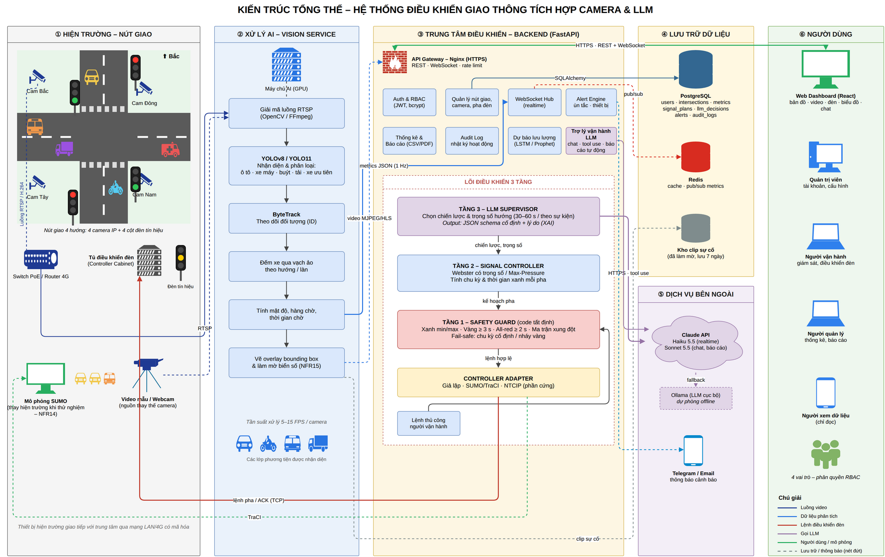

# STCS — Phần mềm điều khiển giao thông tích hợp camera & LLM

Hệ thống giám sát và điều khiển nút giao thông qua camera: nhận diện & đếm phương tiện bằng AI, đánh giá mật độ,
tối ưu chu kỳ đèn bằng **kiến trúc điều khiển 3 tầng**:

| Tầng | Thành phần | Vai trò |
|------|-----------|---------|
| 3 | **LLM Supervisor** (Groq) | Chọn chiến lược & trọng số ưu tiên 2 trục theo ngữ cảnh, giải thích quyết định |
| 2 | **Webster thích ứng** | Tính chu kỳ & thời gian xanh từng pha mỗi giây |
| 1 | **Safety Interlock + FSM** | Vàng ≥ 3s, toàn đỏ ≥ 2s, xanh tối thiểu, ma trận xung đột, FAILSAFE |

Kèm theo: **trợ lý vận hành AI** (chat tiếng Việt, tool calling, lệnh phải xác nhận), **báo cáo tự động**,
thống kê/đánh giá trước–sau AI, cảnh báo ùn tắc & sự cố thiết bị, nhật ký hoạt động, phân quyền 4 vai trò.



Tài liệu: [`ARCHITECTURE.md`](ARCHITECTURE.md) (thiết kế, Safety FSM, ánh xạ yêu cầu) ·
[`DE_XUAT_DE_TAI.md`](DE_XUAT_DE_TAI.md) (báo cáo đề xuất) · [`docs/diagrams/`](docs/diagrams) (kiến trúc & lưu đồ draw.io).

---

## Mục lục

1. [Yêu cầu hệ thống](#1-yêu-cầu-hệ-thống)
2. [Cài đặt](#2-cài-đặt)
3. [Cấu hình LLM Groq](#3-cấu-hình-llm-groq)
4. [Chạy hệ thống](#4-chạy-hệ-thống)
5. [Tài khoản demo](#5-tài-khoản-demo)
6. [Kịch bản kiểm thử gợi ý](#6-kịch-bản-kiểm-thử-gợi-ý)
7. [Camera thực & YOLO](#7-camera-thực--yolo-tuỳ-chọn)
8. [Biến môi trường](#8-biến-môi-trường)
9. [Kiểm thử tự động](#9-kiểm-thử-tự-động)
10. [Cấu trúc mã nguồn](#10-cấu-trúc-mã-nguồn)
11. [Xử lý sự cố thường gặp](#11-xử-lý-sự-cố-thường-gặp)

---

## 1. Yêu cầu hệ thống

| Thành phần | Phiên bản |
|-----------|-----------|
| Python | ≥ 3.10 (khuyến nghị 3.11) |
| Node.js | ≥ 18 (kèm npm) |
| Git | bất kỳ |
| Docker + Docker Compose | tuỳ chọn, nếu chạy bằng container |
| Khoá API Groq | tuỳ chọn — thiếu khoá thì các tính năng LLM tự tắt |

Hệ điều hành: Linux / macOS. Trên Windows nên dùng **WSL2** (script `start.sh` là bash).

## 2. Cài đặt

```bash
git clone https://github.com/<tai-khoan>/smart-traffic-control.git
cd smart-traffic-control
make install          # tạo backend/.venv + cài thư viện Python, cài node_modules cho frontend
```

Không có `make`? Cài thủ công:

```bash
python3 -m venv backend/.venv
backend/.venv/bin/pip install -r backend/requirements.txt
cd frontend && npm install && cd ..
```

> `./start.sh` cũng tự cài thư viện ở lần chạy đầu nếu chưa có.

## 3. Cấu hình LLM Groq

1. Tạo khoá miễn phí tại <https://console.groq.com/keys>.
2. Tạo file cấu hình (file `.env` **không** được commit — đã có trong `.gitignore`):

   ```bash
   cp backend/.env.example backend/.env
   # mở backend/.env và điền: GROQ_API_KEY=gsk_xxx
   ```

3. Khởi động lại backend. Badge **Groq · openai/gpt-oss-120b** xuất hiện trên thẻ *LLM Supervisor*.

| Tính năng | Ở đâu | Ghi chú |
|-----------|-------|---------|
| LLM Supervisor | *Giám sát & Điều khiển* → thẻ "LLM Supervisor (tầng 3)" | Chế độ *Tắt / Tư vấn / Tự động*; chỉ hoạt động khi nút giao ở AUTO |
| Trợ lý vận hành | *Trợ lý AI & Báo cáo* → tab 1 | Tool lọc theo quyền; lệnh điều khiển cần bấm **Xác nhận thực thi** |
| Báo cáo tự động | tab 2 | 6h / 24h / 7 ngày / 30 ngày, tải `.md` hoặc in |
| Nhật ký quyết định LLM | tab 3 | Lý do, ghi chú lớp kiểm tra, đầu vào & đầu ra thô |

**An toàn:** LLM không bao giờ đặt thời gian pha. Đầu ra JSON được kiểm tra (chiến lược hợp lệ, trọng số 0.5–2.0,
mỗi lần đổi ≤ ±0.5, không mâu thuẫn) rồi mới làm trọng số cho Webster. LLM lỗi / timeout / sai schema → giữ chiến lược
hiện tại; FAILSAFE huỷ mọi chiến lược LLM.

## 4. Chạy hệ thống

### Cách 1 — Phát triển (hot reload)

```bash
./start.sh            # hoặc: make dev
```

- Giao diện: <http://localhost:5173>
- API backend: <http://localhost:8010> · Swagger: <http://localhost:8010/docs>

### Cách 2 — Production một cổng

```bash
./start.sh prod       # hoặc: make prod — build frontend rồi phục vụ toàn bộ tại http://localhost:8010
```

### Cách 3 — Docker

```bash
cp .env.example .env  # điền GROQ_API_KEY (STCS_JWT_SECRET để trống sẽ tự sinh)
docker compose up --build -d
```

Mở <http://localhost:8080>. Dừng: `docker compose down`. Dữ liệu SQLite nằm trong volume `stcs-data`.

### Lệnh hữu ích

| Lệnh | Tác dụng |
|------|----------|
| `./start.sh test` / `make test` | Pytest backend + typecheck frontend |
| `./start.sh reset` / `make reset` | Xoá CSDL, seed lại dữ liệu mẫu ở lần chạy sau |
| `STCS_PORT=8020 ./start.sh` | Đổi cổng backend |
| `make backend` / `make frontend` | Chạy riêng từng phần |

## 5. Tài khoản demo

Màn hình đăng nhập có nút **đăng nhập nhanh**.

| Vai trò | Tài khoản | Mật khẩu | Quyền chính |
|---------|-----------|----------|-------------|
| Quản trị viên | `admin` | `admin123` | Toàn quyền: cấu hình, tài khoản, nhật ký, LLM |
| Người vận hành | `operator` | `operator123` | Điều khiển đèn, chuyển chế độ, duyệt đề xuất LLM, giả lập sự cố |
| Người quản lý | `manager` | `manager123` | Giám sát, thống kê, đánh giá, báo cáo AI, nhật ký (chỉ đọc) |
| Người xem dữ liệu | `viewer` | `viewer123` | Thống kê, cảnh báo, hỏi trợ lý — không xem video (NFR15) |
| (bị khoá) | `operator2` | `operator123` | Kiểm thử thông báo "tài khoản bị khoá" |

> ⚠️ Đây là tài khoản mẫu cho môi trường demo. Khi triển khai thật: đổi mật khẩu, đặt `STCS_JWT_SECRET` mạnh.

## 6. Kịch bản kiểm thử gợi ý

1. **Giám sát** – `operator` → *Giám sát & Điều khiển*: 4 camera có bounding box, ROI, vạch đếm; digital twin đếm ngược.
2. **Điều khiển thủ công an toàn** – *Chuyển pha kế tiếp*: hộp thoại hiển thị Vàng 3s → Toàn đỏ 2s → Pha mới.
3. **LLM Supervisor** – chế độ *Tư vấn* → *Phân tích ngay* → đọc lý do → *Duyệt & áp dụng*; trọng số và thời gian xanh Webster thay đổi.
4. **Trợ lý AI** – hỏi "Tình hình nút giao thế nào?", rồi "Ưu tiên trục Đông–Tây 10 phút" → thẻ đề xuất → *Xác nhận thực thi*.
5. **Fail-safe** – *Giả lập* → ngắt camera hướng Bắc: ≤ 3s chuyển `FAILSAFE`, chiến lược LLM bị huỷ, AUTO bị khoá.
6. **Ùn tắc** – *Đột biến ×3*: cảnh báo đông đúc/ùn tắc, LLM được gọi sớm do sự kiện.
7. **Báo cáo** – `manager` → *Trợ lý AI & Báo cáo* → *Báo cáo tự động* → *Sinh báo cáo*; *Phân tích & Đánh giá* so sánh trước/sau AI.
8. **Quản trị** – `admin`: CRUD nút giao, camera (kéo-thả ROI), ngưỡng, ràng buộc an toàn, tài khoản, nhật ký.

## 7. Camera thực & YOLO (tuỳ chọn)

Mặc định camera là luồng mô phỏng (render trên canvas). Để dùng RTSP/HTTP/tệp video và YOLO thật:

```bash
backend/.venv/bin/pip install -r backend/requirements-vision.txt
```

Vào *Nút giao & Cấu hình → Camera*, đổi nguồn sang `RTSP` / `HTTP` / `FILE` và nhập Stream URL. Luồng đã chú thích AI
được phục vụ qua MJPEG `GET /api/cameras/{id}/stream.mjpg`. Trọng số `*.pt` và video mẫu không được commit (xem `.gitignore`).

## 8. Biến môi trường

Đặt trong `backend/.env` (chạy trực tiếp) hoặc `.env` ở thư mục gốc (Docker). Biến môi trường hệ thống được ưu tiên.

| Biến | Mặc định | Ý nghĩa |
|------|----------|---------|
| `STCS_PORT` | `8010` | Cổng backend |
| `STCS_DATABASE_URL` | `sqlite:///backend/data/stcs.db` | Chuỗi kết nối CSDL |
| `STCS_JWT_SECRET` | *(trống)* | Chuỗi ngẫu nhiên ≥ 32 ký tự. Bỏ trống → tự sinh và lưu ở `STCS_JWT_SECRET_FILE` (mặc định `backend/data/.jwt_secret`). Giá trị yếu/giá trị mẫu → từ chối khởi động |
| `STCS_JWT_EXPIRE_MINUTES` | `480` | Thời hạn phiên đăng nhập |
| `STCS_TRUSTED_PROXIES` | `127.0.0.1,::1` | IP/CIDR của reverse proxy được tin để đọc `X-Forwarded-For` (IP ghi audit). Docker compose đặt dải mạng nội bộ |
| `STCS_CORS_ORIGINS` | `http://localhost:5173,…` | Origin được phép |
| `STCS_SEED` | `1` | Seed dữ liệu mẫu khi CSDL trống |
| `STCS_RESET_DB` | `0` | `1` = xoá và tạo lại CSDL khi khởi động |
| `GROQ_API_KEY` | (trống) | Khoá Groq; trống = tắt mọi tính năng LLM |
| `GROQ_BASE_URL` | `https://api.groq.com/openai/v1` | Endpoint OpenAI-compatible |
| `STCS_LLM_MODEL` | `openai/gpt-oss-120b` | Model cho Supervisor, trợ lý, báo cáo |
| `STCS_LLM_MODE` | `ADVISORY` | Chế độ Supervisor khi khởi động: `OFF` / `ADVISORY` / `AUTONOMOUS` |
| `STCS_LLM_INTERVAL_S` | `60` | Chu kỳ phân tích định kỳ (giây) |
| `STCS_LLM_TIMEOUT_S` | `8` | Timeout mỗi lần gọi Supervisor |

## 9. Kiểm thử tự động

```bash
cd backend && .venv/bin/python -m pytest tests -q
cd frontend && npx tsc -b --noEmit
```

- `tests/test_safety_fsm.py` – ma trận xung đột, trình tự bắt buộc, min green, fuzz 30.000 bước lệnh, fail-safe, Webster.
- `tests/test_api.py` – đăng nhập/khoá tạm, RBAC, xác nhận an toàn (HTTP 428), FAILSAFE khi mất camera, cấu hình, thống kê.
- `tests/test_llm.py` – lớp kiểm tra đầu ra LLM, trọng số Webster, luồng Tư vấn → Duyệt, chặn đầu ra sai schema,
  trợ lý chỉ thực thi sau xác nhận, vai trò Người xem. LLM được giả lập — **không cần khoá Groq để chạy test**.

## 10. Cấu trúc mã nguồn

```
smart-traffic-control/
├── backend/
│   ├── app/
│   │   ├── api/            REST routers + WebSocket /ws/live
│   │   ├── core/           config, JWT/bcrypt, RBAC, audit, event bus
│   │   ├── control_engine/ phases, safety interlock, FSM, Webster (adaptive), adapter
│   │   ├── vision_engine/  simulator, detector (synthetic/YOLO), tracker, counter, density, stream manager
│   │   ├── llm/            client Groq, LLM Supervisor (tầng 3), trợ lý & báo cáo
│   │   ├── models/ schemas/ services/
│   ├── tests/
│   ├── .env.example
│   └── requirements.txt · requirements-vision.txt · Dockerfile · run.py
├── frontend/               React 18 · TypeScript · Vite · Tailwind · Recharts · Lucide
│   └── src/ (pages, components, context, lib)
├── docs/diagrams/          he_thong.drawio + PNG (kiến trúc, 3 lưu đồ)
├── ARCHITECTURE.md · DE_XUAT_DE_TAI.md
├── docker-compose.yml · Makefile · start.sh · .env.example
```

## 11. Xử lý sự cố thường gặp

| Hiện tượng | Cách xử lý |
|-----------|-----------|
| `Address already in use` cổng 8010 | `STCS_PORT=8020 ./start.sh` |
| Giao diện báo "Không kết nối được máy chủ" | Kiểm tra backend đang chạy; ở chế độ dev frontend proxy tới `STCS_BACKEND` |
| Thẻ LLM hiện "Chưa có khoá Groq" | Điền `GROQ_API_KEY` trong `backend/.env`, khởi động lại backend |
| LLM báo `Groq HTTP 429` | Vượt hạn mức gói miễn phí — tăng `STCS_LLM_INTERVAL_S` hoặc đổi model nhỏ hơn |
| LLM Supervisor không chạy | Nút giao phải ở chế độ **AUTO** và Supervisor không ở *Tắt* |
| Dữ liệu cũ / lỗi CSDL sau khi cập nhật | `./start.sh reset` rồi chạy lại |
| `python3 -m venv` lỗi trên Ubuntu | `sudo apt install python3-venv` |
